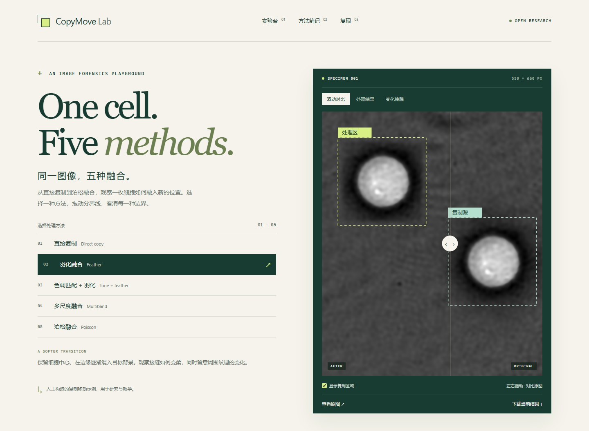

# CopyMove Lab

**One cell. Five methods.** A small, reproducible image-forensics playground built around one CC0 quantitative phase microscopy image.



[中文](README.md) · [Licenses and provenance](NOTICE.md) · [Method details](docs/METHODS.md)

## Explore

Open `docs/index.html` directly. No server, installation, external fonts or API key is needed for the demo. Switch methods, wipe between original and result, inspect actual change masks and compare close-ups. The interface is in Chinese; method names also include English labels.

## Reproduce

Requires Python 3.10+:

```sh
python -m pip install -e .
python -m copymove_lab --image examples/cell/original.png --source 315 265 535 485 --target 40 65 --output runs/cell
```

Use your own authorized image with new coordinates. `--source` is a half-open native-pixel rectangle; `--target` is the destination top-left. Source and destination must be in bounds and non-overlapping, with a minimum patch size of 16 × 16. The image is converted to RGB uint8 without automatic EXIF rotation. Orient images before selecting coordinates; this is not a quantitative high-bit-depth image pipeline. Existing nonempty output directories are never overwritten.

Five methods are implemented: `hard`, `feather`, `tone_feather`, `multiband`, `poisson`. The Poisson method uses OpenCV NORMAL_CLONE followed by feather restoration. Multiband uses a three-level Laplacian pyramid and a final boundary gate. See [the exact contracts](docs/METHODS.md).

Exports include native-size RGB outputs, planned source/target masks, per-method actual change masks and a manifest containing coordinates, parameters, versions and SHA256 hashes. Every method preserves all pixels outside the target. Only hard copy preserves the entire copied patch exactly; feather preserves its core.

The demo's original PNG matches the scikit-image 0.25.2 registry hash. Environment versions are in the manifest and `requirements-demo.txt`. OpenCV versions/platforms may differ slightly in numerical results; cross-platform byte identity is not promised.

## Develop

```sh
python -m pip install -e ".[dev]"
python -m pytest -q
python -m ruff check .
```

Optional browser verification: install `playwright`, run `python -m playwright install chromium`, then `python scripts/browser_check.py`. Generated screenshots remain in ignored `runs/`.

To refresh the static demo after generating a new export with the bundled image and fixed event, run `python scripts/update_demo.py --from runs/cell`. This checks provenance, geometry and every image hash before updating assets.

The portable agent skill is at `skills/copymove-lab/SKILL.md`; read it in place or copy its folder into your agent's skills directory. For GitHub Pages choose **main / docs** in repository Pages settings after pushing.

## Scope and licensing

These are explicitly synthetic copy-move examples for research and education, not new experimental observations, a benchmark or evidence of general method superiority. No AI result or detection accuracy is claimed.

Code and original documentation: [MIT](LICENSE). Original image and generated sample image assets: **CC0-1.0**, compatible with redistribution alongside MIT code. See [NOTICE.md](NOTICE.md) for the source, scientific citation and license evidence.
