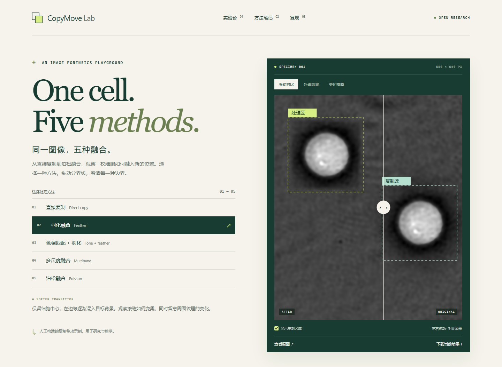

# CopyMove Lab

**One cell. Five methods.**

一个可复现的科研图像复制移动实验台。固定一张 CC0 显微图的复制区域和目标位置，对比五种真实的传统融合方法。

**MIT 代码 · CC0 示例图 · 无 API 密钥 · 纯静态交互页面**



[English](README.en.md) · [图像来源与许可](NOTICE.md) · [方法说明](docs/METHODS.md) · [AI 助手 Skill](skills/copymove-lab/SKILL.md)

## 直接体验

下载仓库后，打开 **`docs/index.html`** 即可使用，无需安装 Python，也无需启动服务器。支持方法切换、原图/结果滑动比较、真实变化掩膜、复制区域标记、局部放大和结果下载。

如需本地服务，在仓库目录运行 `python -m http.server 8000 --directory docs`，访问 http://localhost:8000 。

## 运行自己的实验

Python 3.10 或以上。在仓库根目录安装：

```sh
python -m pip install -e .
```

运行随仓库提供的示例（Windows/macOS/Linux 通用）：

```sh
python -m copymove_lab --image examples/cell/original.png --source 315 265 535 485 --target 40 65 --output runs/cell
```

将 `--image` 换成你有权使用的图像，并调整坐标，即可处理其他图片。也可用 `--methods hard feather` 仅运行指定方法。安装后提供等价的 `copymove-lab` 命令。

- `--source x0 y0 x1 y1`：原生像素坐标，左上包含、右下不包含。
- `--target x y`：目标左上角，大小与源区域相同，不旋转、不缩放。
- 源与目标不允许重叠，必须在图内；复制块至少为 16 × 16 像素。
- 输入转为 RGB 8-bit；不自动应用 EXIF 旋转。请先统一方向，再选坐标。此工具不保留定量原始高位深数据。
- 输出目录必须不存在或为空，防止覆盖已有实验。

## 五种方法

| 方法 | 命令中的名称 | 主要行为 |
|---|---|---|
| 直接复制 | `hard` | 复制整个源块，逐像素保留 |
| 羽化 | `feather` | 中心保留，边缘平滑过渡 |
| 色调匹配＋羽化 | `tone_feather` | 背景中位颜色差校正，再羽化 |
| 多尺度融合 | `multiband` | 三层拉普拉斯金字塔融合＋边界约束 |
| 泊松融合 | `poisson` | OpenCV NORMAL_CLONE＋羽化恢复 |

泊松和多尺度版本包含明确的边界处理，不应与未加后处理的教科书基线混为一谈。五种方法的几何位置完全相同；原图和目标范围以外的像素保持不变。只有 `hard` 保证整个复制块逐像素相同，`feather` 保证其中心区域。

## 实验输出

每次运行产生原图的 RGB 副本、五张结果图、源区域掩膜、目标区域掩膜、每种方法的真实变化掩膜，以及 `manifest.json`。清单记录坐标、有效参数、环境版本、变化像素数和所有图片 SHA256。

计划目标掩膜与实际变化掩膜不是同一个概念；黑色表示未发生变化。CLI 不执行“视觉合格”判定，变化像素数也不是效果排名。

示例只用于展示算法行为，不是新采集的实验数据，也不是经过独立样本验证的检测基准。请在传播衍生图时保留“人工复制移动示例”的说明。

## 复现网页资源

网页资源已包含在仓库中。修改代码后可先生成一个新目录，再更新示例：

```sh
python -m copymove_lab --image examples/cell/original.png --source 315 265 535 485 --target 40 65 --output runs/cell-v2
python scripts/update_demo.py --from runs/cell-v2
```

更新脚本仅接受这个已公开的 CC0 样例及固定坐标，避免在不更新来源说明时替换图片。自定义实验使用 CLI 输出即可；如果要换网页的演示图，同时更新来源、许可、页面文案与坐标。

环境版本记录在清单中。跨 OpenCV 版本或平台，尤其是泊松求解，可能产生少量像素差异；本项目保证可核查流程，不承诺所有平台上的 PNG 字节相同。`requirements-demo.txt` 固定相同核心库版本；原示例使用标准 OpenCV 包，安装清单使用对应的 headless 构建，无需桌面窗口支持。

## 测试与贡献

```sh
python -m pip install -e ".[dev]"
python -m pytest -q
python -m ruff check .
```

测试检查原图保护、坐标映射、边界、非法输入、掩膜和哈希；CI 在 Linux 和 Windows 上运行。浏览器检查为可选项：安装 `playwright` 并运行 `python -m playwright install chromium`，再执行 `python scripts/browser_check.py`。

新方法应使用同一事件定义，保留目标以外的像素，并提供有效参数和变化掩膜。不要用已有方法的结果冒充未实现的方法。

## AI 助手 Skill

仓库自带 `skills/copymove-lab/SKILL.md`。可以直接让助手读取它；也可以把整个 skill 文件夹复制到助手使用的 skills 目录。说明不依赖作者机器上的绝对路径，也不需要旧项目资料。这个 skill 用于图像复制移动实验，不负责普通插图生成。

## 发布到 GitHub Pages

推送仓库后，在 GitHub **Settings → Pages** 选择 **Deploy from a branch**，指定 **main / docs**。所有资源均使用相对路径，兼容项目子路径；没有分析追踪、远程字体或运行时外部资源请求。

## 许可

代码与原创文档使用 [MIT](LICENSE)。细胞原图及示例图像使用 **CC0-1.0**，可与 MIT 项目一同分发；其许可并没有被改写为 MIT。完整来源、论文和原始文件校验值见 [NOTICE.md](NOTICE.md)。
